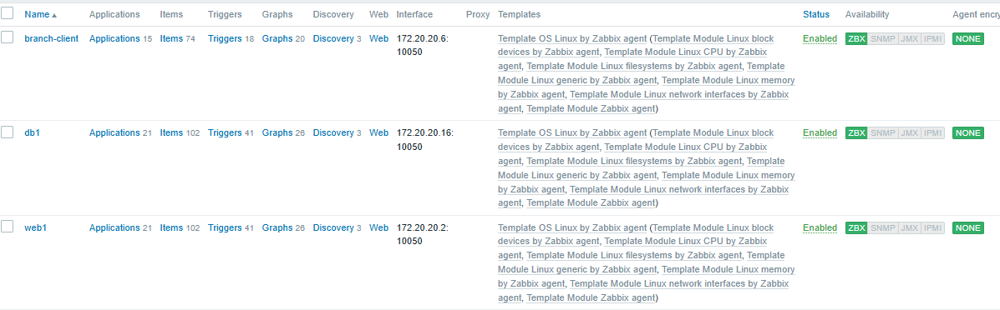
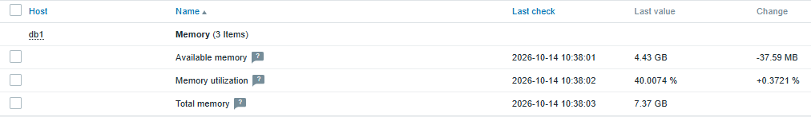
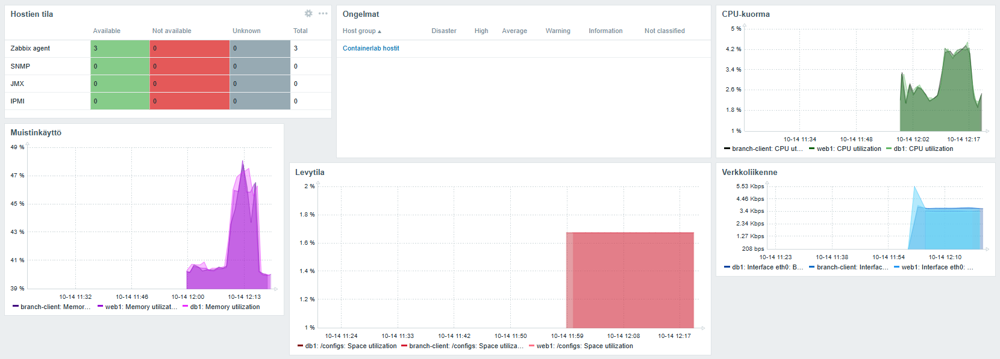
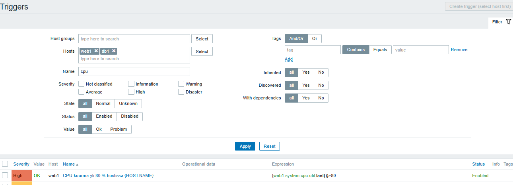
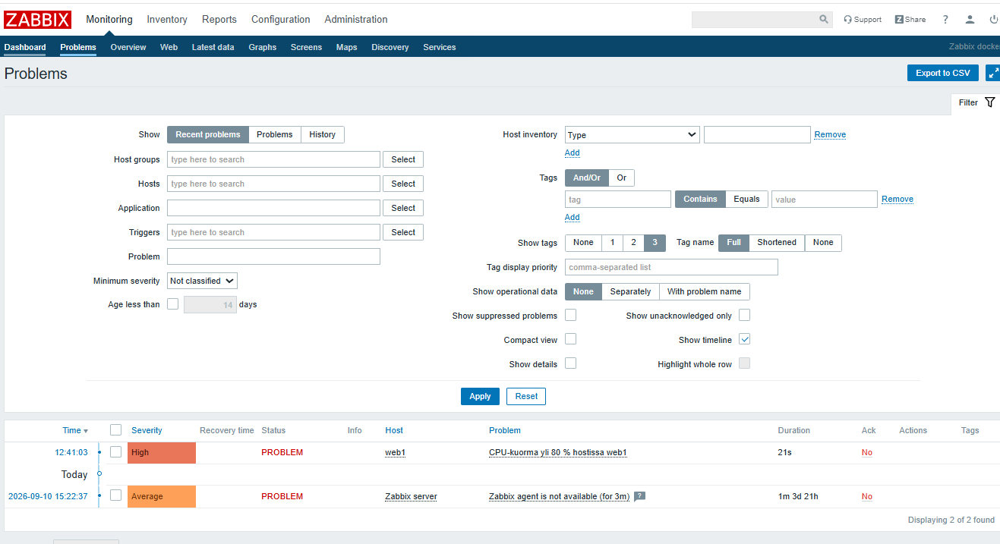
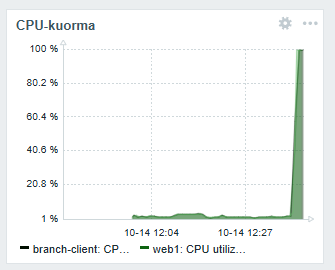
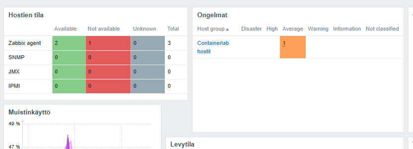

# Viikko 6 – Zabbix ja keskitetty verkonvalvonta

## 1. Johdanto

Zabbix on avoimen lähdekoodin valvontajärjestelmä, jolla seurataan IT-infrastruktuurin tilaa ja suorituskykyä. Sitä kehittää latvialainen Zabbix SIA, ja se on ilmainen myös kaupallisessa käytössä. Zabbixilla voi valvoa palvelimia, virtuaalikoneita, kontteja, verkkolaitteita, pilvipalveluja ja sovelluksia keskitetysti yhdestä paikasta.

Zabbix kerää mittaustietoa kohteista useilla tavoilla: agenteilla, SNMP:llä, agentittomilla tarkistuksilla ja rajapintojen kautta. Kerätty tieto tallennetaan tietokantaan historiaksi ja trendeiksi. Triggerit vertaavat arvoja määriteltyihin ehtoihin. Kun ehto täyttyy, syntyy ongelma (event), joka näkyy käyttöliittymässä ja voi käynnistää toimenpiteen, kuten ilmoituksen ylläpidolle tai automaattisen korjauskomennon.

Zabbixia käytetään vikojen havaitsemiseen ja niihin reagoimiseen ennen kuin ne näkyvät käyttäjille. Sillä seurataan myös resurssien käyttöä kapasiteetin suunnittelua varten ja todennetaan palvelujen saatavuutta raporteilla. Templatejen, automaattisen löytämisen ja proxyjen ansiosta sama järjestelmä toimii yhden palvelimen testiympäristöstä tuhansien laitteiden hajautettuun ympäristöön.

### Zabbixin käyttöliittymä (tehtävä 6.1)

#### Hosts

Host on valvottava kohde, ja siitä Zabbixin ketju host → item → trigger → event → action alkaa. Hosts-näkymässä (Configuration → Hosts) on yksi host, Zabbix server. Sen rajapinta on agenttirajapinta 127.0.0.1:10050, ja sen tila on Enabled.

Hostille on määritetty 12 sovellusta (applications), 88 itemiä, 48 triggeriä, 14 graafia ja 3 löytösääntöä (discovery). Agentin salaus on pois päältä (NONE).

Saatavuussarakkeessa ZBX-merkki on punainen. Server ei siis saa yhteyttä agenttiin. Docker-ympäristössä tämä on odotettavaa: zabbix-appliance-kontissa on server, tietokanta ja web-käyttöliittymä, mutta ei agenttia. Osoitteessa 127.0.0.1:10050 ei siis vastaa kukaan.

#### Templates

Template on uudelleenkäytettävä kokoelma itemeitä, triggereitä, graafeja ja löytösääntöjä. Sama template voidaan liittää useaan hostiin. Zabbix server -hostiin on liitetty kaksi templatea:

- **Template App Zabbix Server**, joka valvoo palvelimen sisäisiä prosesseja ja suorituskykyä.
- **Template OS Linux by Zabbix agent**, joka koostuu moduuleista: block devices, CPU, filesystems, generic, memory, network interfaces ja Zabbix agent.

Hostin itemit ja triggerit tulevat siis templateista eikä niitä ole tehty käsin. Järjestelmätietojen mukaan ympäristössä on 138 templatea valmiina käytettäväksi.

#### Monitoring

Monitoring-valikko on operatiivinen näkymä, jossa seurataan kerättyä tietoa. Sen alivalikot ovat Dashboard, Problems, Overview, Web, Latest data, Graphs, Screens, Maps, Discovery ja Services. Configuration-puolella määritellään, mitä valvotaan. Monitoring näyttää, mitä tapahtuu.

Mapsissa on yksi kartta, Local network (680 × 200). Sitä ei ole lisätty suosikkeihin, joten dashboardin Favourite maps -widget on tyhjä.

#### Dashboards

Dashboard Global view kokoaa ympäristön tilan widgetteihin:

- **System information:** server on käynnissä (localhost:10051). Itemeistä 83 on käytössä ja 5 ei-tuettuja. Triggereitä on 48, joista 1 on ongelmatilassa ja 47 OK-tilassa. Käyttäjiä on 2, joista 1 on online. Palvelimen kuorma on 1,27 uutta arvoa sekunnissa.
- **Host availability:** 1 host yhteensä, ja se on tilassa Not available.
- **Problems by severity:** 1 ongelma, jonka vakavuus on Average.
- **Problems:** Zabbix agent is not available (for 3m) hostissa Zabbix server. Ongelma alkoi 10.9.2026, ja se on ollut auki yli kuukauden (1m 3d 17h).
- Lisäksi kello ja tyhjä Favourite maps.

#### Alerts

Hälytys syntyy, kun trigger muuttuu PROBLEM-tilaan ja siitä syntyy event. Tässä ympäristössä triggeri "Zabbix agent is not available" on lauennut, ja siitä on syntynyt Average-tasoinen ongelma. Ongelmaa ei ole kuitattu (Ack: No), eikä Actions-sarakkeessa näy suoritettuja toimenpiteitä. Ilmoituksia ei ole lähetetty: Action log on tyhjä, ja Zabbixin oletusaction *Report problems to Zabbix administrators* on oletuksena pois päältä (Disabled).

Hälytysten toimenpiteet määritellään kohdassa Configuration → Actions ja ilmoituskanavat (sähköposti, Slack ym.) kohdassa Administration → Media types.

#### Reports

Reports-valikko sisältää raportteja pidemmän aikavälin tarkasteluun:

- **System information:** Zabbix-serverin tila ja tunnusluvut (hostien, itemien ja triggerien määrät, käyttäjät, palvelimen kuorma).
- **Availability report:** kuinka suuren osan ajasta triggerit ovat olleet OK- ja PROBLEM-tilassa.
- **Triggers top 100:** useimmin lauenneet triggerit.
- **Audit:** kuka muutti konfiguraatiota ja milloin.
- **Action log:** lähetetyt ilmoitukset ja suoritetut toimenpiteet.
- **Notifications:** lähetettyjen ilmoitusten määrät käyttäjittäin ja mediatyypeittäin aikajaksoittain.

## 2. Hostien lisääminen

### Ympäristö

Kurssin Zabbix on `zabbix/zabbix-appliance`-kontti (Zabbix **4.4.6**), joka sisältää serverin, MySQL-tietokannan ja web-käyttöliittymän (http://localhost:8080). Versio on vanha, joten käyttöliittymä ja templatejen nimet poikkeavat tehtävänannosta: esimerkiksi "Linux by Zabbix agent" on tässä versiossa nimeltään **Template OS Linux by Zabbix agent**.

Valvottavat hostit ovat containerlab-topologian Ubuntu 24.04 -kontteja. Zabbix-server tavoittaa ne mgmt-verkon (172.20.20.0/24, eth0) kautta:

| Host | IP-osoite (eth0) | Host group | Template | Valvontatapa |
|---|---|---|---|---|
| web1 | 172.20.20.2 | Containerlab hostit | Template OS Linux by Zabbix agent | Zabbix agent 2, TCP 10050 |
| db1 | 172.20.20.16 | Containerlab hostit | Template OS Linux by Zabbix agent | Zabbix agent 2, TCP 10050 |
| branch-client | 172.20.20.6 | Containerlab hostit | Template OS Linux by Zabbix agent | Zabbix agent 2, TCP 10050 |

### Zabbix agent 2:n asennus

Hosteilla oli valmiina snmpd (Week02), mutta valvontaan valittiin Zabbix-agentti, koska se antaa monipuolisemmat mittarit (mm. levyt, prosessit, CPU:n osa-ajat). Agentti asennettiin jokaiseen konttiin root-shellissä (`docker exec -it <kontti> bash`) zabbix.comin ohjeen mukaisesti (Zabbix 7.4, Ubuntu 24.04, Agent 2):

```bash
wget https://repo.zabbix.com/zabbix/7.4/release/ubuntu/pool/main/z/zabbix-release/zabbix-release_latest_7.4+ubuntu24.04_all.deb
dpkg -i zabbix-release_latest_7.4+ubuntu24.04_all.deb
apt update
apt install zabbix-agent2
```

Konfiguraatiotiedostoon `/etc/zabbix/zabbix_agent2.conf` muutettiin kolme riviä (esimerkkinä web1):

```text
Server=172.20.20.0/24
ServerActive=172.20.20.14
Hostname=web1
```

- `Server` kertoo, mistä osoitteista agentti hyväksyy passiiviset kyselyt (koko mgmt-verkko).
- `ServerActive` on Zabbix-serverin osoite aktiivisia tarkistuksia varten.
- `Hostname` pitää olla täsmälleen sama kuin hostin nimi Zabbixissa.

Ohjeen viimeinen vaihe `systemctl restart zabbix-agent2` ei toiminut, koska kontin PID 1 on bash eikä systemd ("System has not been booted with systemd as init system"). Asennus ei myöskään käynnistänyt palvelua (`policy-rc.d denied execution of start`). Agentti käynnistettiin siksi käsin taustalle:

```bash
setsid nohup zabbix_agent2 -c /etc/zabbix/zabbix_agent2.conf >/dev/null 2>&1 &
```

Yhteys testattiin Zabbix-serverin kontista `zabbix_get`-työkalulla, joka palautti `1`:

```bash
docker exec clab-hamk-verkonhallinta-golden-zabbix zabbix_get -s 172.20.20.2 -k agent.ping
```

Huom: agentti ei käynnisty automaattisesti uudelleen, jos kontti käynnistetään uudelleen.

### Hostien luonti Zabbixissa

Hostit luotiin kohdassa Configuration → Hosts → Create host: Host name, host group *Containerlab hostit*, agenttirajapinta (IP, portti 10050) ja Templates-välilehdellä *Template OS Linux by Zabbix agent*. Zabbix 4.4:ssä template pitää ensin lisätä kentän alla olevalla pienellä Add-linkillä ennen lomakkeen tallennusta.

Uusi host näkyi aluksi punaisena / harmaana, ja ZBX-merkki muuttui vihreäksi 1–2 minuutin kuluttua, kun server oli tehnyt ensimmäisen kyselynsä. Agentin lokissa näkyi alussa `host [branch-client] not found`, koska agentti käynnistettiin ennen kuin host oli luotu Zabbixiin.



Templaten moduulit (block devices, CPU, filesystems, generic, memory, network interfaces, Zabbix agent) toivat jokaiselle hostille noin sata itemiä ja kymmeniä triggereitä. Osa itemeistä (levyt, tiedostojärjestelmät, verkkoliitännät) syntyy löytösäännöistä (discovery), joten niiden määrä kasvoi vielä hostin lisäämisen jälkeen. Kuvakaappaushetkellä branch-clientin löytö oli vielä kesken.

### Mittareiden saapuminen (db1)

Latest data -näkymästä tarkistettiin, että db1:ltä saapuvat tehtävässä vaaditut tiedot:





## 3. Dashboard

Loin dashboardin **Golden Topology Status** (Monitoring → Dashboard → All dashboards → Create dashboard). Widgetit:

| Widget | Tyyppi | Sisältö |
|---|---|---|
| Hostien tila | Host availability | Host group *Containerlab hostit*: Available / Not available / Unknown rajapinnoittain |
| Ongelmat | Problems by severity | Avoimet ongelmat vakavuusluokittain |
| CPU-kuorma | Graph | web1, db1, branch-client: *CPU utilization* |
| Muistinkäyttö | Graph | samat hostit: *Memory utilization* |
| Levytila | Graph | samat hostit: */configs: Space utilization* |
| Verkkoliikenne | Graph | samat hostit: *Interface eth0: Bits\** (received ja sent) |



Dashboardista näkee yhdellä silmäyksellä, ovatko kaikki agentit saatavilla, onko avoimia ongelmia ja miten resurssien käyttö kehittyy.

Kuvaajissa näkyy sama havainto kuin mittarianalyysissä (osio 4): CPU-, muisti- ja levykuvaajien viivat ovat kaikilla kolmella hostilla käytännössä päällekkäin, koska kontit jakavat WSL:n Linux-ytimen ja agentti lukee arvot ytimen `/proc`-tiedostoista. Levytilakuvaaja näyttää WSL-levyltä bind-mountatun /configs-hakemiston, koska kontin oma juuri `/` (overlay) ei kuulu löytösäännön piiriin. Verkkoliikenne sen sijaan on hostikohtaista, koska jokaisella kontilla on oma eth0-liitäntä.

## 4. Mittarit

### Valvontamittarien analyysi – host db1

Analyysi perustuu Zabbixin Latest data -näkymästä haettuihin arvoihin hostista db1 (14.10.2026 klo 10.36–10.39) sekä hostien vertailutaulukkoon. Listassa on kuusi mittaria, joten kaikki kuusi on dokumentoitu.

#### 1. CPU Usage

- **Mittari:** CPU utilization
- **Arvo:** 2,12 % (muutos −0,55 %)
- **Mitä kertoo:** Kuinka suuren osan ajasta suorittimet ovat töissä. Loput ajasta ne ovat joutilaina.
- **Miksi seurata:** Jatkuvasti korkea käyttöaste, esimerkiksi yli 80–90 %, hidastaa palveluja ja kertoo kapasiteetin loppumisesta tai karanneesta prosessista. Tietokantapalvelimella CPU-piikki voi johtua raskaista kyselyistä. Nyt kuorma on hyvin pieni.

#### 2. Memory Usage

- **Mittarit:** Memory utilization ja Available memory
- **Arvo:** 40,13 % käytössä, 4,41 GB vapaana (muistia yhteensä 7,37 GB)
- **Mitä kertoo:** Kuinka paljon keskusmuistista on käytössä ja kuinka paljon on vielä sovellusten käytettävissä.
- **Miksi seurata:** Kun muisti loppuu, järjestelmä alkaa käyttää swapia ja hidastuu. Pahimmassa tapauksessa käyttöjärjestelmä lopettaa prosesseja (OOM killer). Tietokannalle muisti on erityisen tärkeää, koska se käyttää sitä välimuistina. Nykyinen 40 % jättää runsaasti varaa.

#### 3. Load Average

- **Mittari:** Load average (1m avg)
- **Arvo:** 0,22 (vertailutaulukossa aiemmin 0,52)
- **Mitä kertoo:** Kuinka monta prosessia keskimäärin odottaa suoritinta tai on suorituksessa. Arvo on keskiarvo viimeisen minuutin ajalta.
- **Miksi seurata:** Kuorman voi suhteuttaa ytimien määrään. Jos load on pysyvästi suurempi kuin ytimiä (tässä 12), prosessit joutuvat jonoon. Arvo 0,22 tarkoittaa noin 0,02:ta ydintä kohden, eli kuormaa ei käytännössä ole. Load average paljastaa myös levyn I/O-odotuksen, jota CPU-prosentti ei näytä.

#### 4. Uptime

- **Mittari:** System uptime
- **Arvo:** 02:19:26 (vertailutaulukossa 7881 s ≈ 2 h 11 min)
- **Mitä kertoo:** Aika järjestelmän viimeisestä käynnistyksestä.
- **Miksi seurata:** Uptime paljastaa odottamattomat uudelleenkäynnistykset. Jos arvo yllättäen nollautuu, kone on kaatunut tai käynnistetty uudelleen. Hyvin pitkä uptime taas voi tarkoittaa, että päivitykset ovat jääneet asentamatta.

#### 5. Disk Usage

- **Mittari:** /configs: Space utilization
- **Arvo:** 1,67 %
- **Mitä kertoo:** Kuinka suuri osa tiedostojärjestelmän tilasta on käytössä.
- **Miksi seurata:** Täysi levy pysäyttää tietokannan kirjoitukset ja lokituksen ja voi kaataa palveluja. Tilan kasvua kannattaa seurata trendinä, jotta loppuminen voidaan ennakoida. Tyypillinen trigger laukeaa, kun käyttöaste ylittää 80–90 %.
- **Huomio:** /configs ei ole db1:n oma levy, vaan WSL:n levyltä bind-mountattu hakemisto. Kontin juurijärjestelmä `/` (Dockerin overlay) puuttuu valvonnasta kokonaan, koska templaten löytösääntö suodattaa overlay-tiedostojärjestelmät pois.

#### 6. Network Traffic

- **Mittarit:** Interface eth0: Bits received ja Bits sent
- **Arvo:** vastaanotettu 3,7 Kbps (−176 bps), lähetetty 3,54 Kbps (−112 bps)
- **Mitä kertoo:** Verkkoliikenteen määrä rajapinnan kautta kumpaankin suuntaan.
- **Miksi seurata:** Liikenteen kasvu voi kertoa kuorman lisääntymisestä, varmuuskopioinnista tai poikkeavasta toiminnasta, kuten hyökkäyksestä. Liikenteen äkillinen loppuminen viittaa yhteysongelmaan. Nykyinen liikenne on todennäköisesti lähinnä valvontaliikennettä.

### Yhteenvetotaulukko

| Mittari | Arvo | Merkitys |
|---|---|---|
| CPU Usage | 2,12 % | Suoritin lähes joutilas, kapasiteettia runsaasti |
| Memory Usage | 40,1 % (4,41 GB vapaana) | Muistia riittävästi, ei swap-riskiä |
| Load Average (1 min) | 0,22 | Ei jonoutumista, kun ytimiä on 12 |
| Uptime | 2 h 19 min | WSL-isännän käynnissäoloaika, ei kontin oma (kontit jakavat ytimen) |
| Disk Usage (/configs) | 1,67 % | Levytilaa runsaasti |
| Network Traffic (eth0) | ↓ 3,7 Kbps / ↑ 3,54 Kbps | Vähäinen liikenne, todennäköisesti lähinnä valvontaliikennettä |

### Havainnot

Kaikki mittarit ovat normaalitasolla, eikä yksikään lähesty tyypillisiä hälytysrajoja. db1 on tällä hetkellä käytännössä kuormittamaton testiympäristö.

Hostien vertailussa näkyy, että web1, db1 ja branch-client raportoivat samat uptime-, CPU- ja muistiarvot kuin WSL-isäntä. Tämä johtuu siitä, että hostit ovat Docker-kontteja, jotka jakavat WSL:n Linux-ytimen. Ne näkevät isännän kokonaisresurssit, eivät kontin omia rajoja. Poikkeus on prosessimäärä (3), joka on aidosti konttikohtainen, koska jokaisella kontilla on oma PID-nimiavaruus.

Muutoksen sarake (esim. −0,55 %) näyttää eron edelliseen mittaukseen. Yksittäisen arvon sijaan tulkinnassa kannattaa käyttää trendiä Graph-näkymässä.

## 5. Triggerit

Template sisältää valmiita triggereitä, mutta niiden rajat ovat tehtävän vaatimuksia korkeammat: esimerkiksi *High CPU utilization (over 90% for 5m)* ja */configs: Disk space is critically low (used > 90%)*. Siksi loin kaksi omaa triggeriä (Configuration → Hosts → Triggers → Create trigger):

| Triggerin nimi | Host | Ehto (expression) | Vakavuus |
|---|---|---|---|
| CPU-kuorma yli 80 % hostissa {HOST.NAME} | web1 | `{web1:system.cpu.util.last()}>80` | High |
| Vapaa levytila alle 20 % ({HOST.NAME}: /configs) | db1 | `{db1:vfs.fs.size[/configs,pused].last()}>80` | Average |



- `{HOST.NAME}` on makro, jonka tilalle Zabbix sijoittaa hostin nimen hälytyksessä.
- `last()` vertaa viimeisintä mitattua arvoa. Template käyttää omissa triggereissään aikaikkunaa (esim. `avg(5m)`), jolloin yksittäinen piikki ei aiheuta hälytystä. `last()` valittiin, jotta testi reagoi nopeasti.
- Templatessa ei ole levytilalle "vapaana %" -itemiä, vain käyttöaste (*Space utilization*, `pused`). Ehto "vapaata alle 20 %" on siksi kirjoitettu muotoon "käytössä yli 80 %".
- Vakavuusluokat: CPU:n ylikuorma on **High**, koska se vaikuttaa palveluihin välittömästi. Levytilan väheneminen on **Average**, koska se kehittyy yleensä hitaasti ja siihen ehtii reagoida.

## 6. Hälytys- ja häiriötestit

### Hälytyksen simulointi (CPU, vaihtoehto A)

Tehtävänannon `yes > /dev/null` kuormittaa vain yhtä ydintä. Koska *CPU utilization* mittaa koko WSL-virtuaalikonetta (12 ydintä), yksi prosessi nostaisi käyttöastetta vain noin 8 %. Ajoin siksi web1:ssä 12 rinnakkaista `yes`-prosessia, jotka `timeout` lopetti viiden minuutin kuluttua:

```bash
W=clab-hamk-verkonhallinta-golden-web1
docker exec -d $W bash -c 'for i in $(seq 12); do timeout 300 yes >/dev/null & done; wait'
```

| Aika | Tapahtuma |
|---|---|
| ~12:40 | Kuorma käynnistetty |
| 12:41:03 | PROBLEM: *CPU-kuorma yli 80 % hostissa web1* (High) |
| 12:45:03 | RESOLVED, kun `timeout` lopetti prosessit |





Havainnot:

- Hälytys ilmestyi muutamassa kymmenessä sekunnissa. Viiveen yläraja on CPU-itemin keruuväli (1 min), koska `last()` reagoi heti seuraavaan mitattuun arvoon.
- CPU-kuvaaja nousi 100 %:iin kaikilla kolmella hostilla, vaikka kuorma ajettiin vain web1:ssä. Tämä johtuu jaetusta ytimestä. Oikeassa ympäristössä, jossa hostit ovat erillisiä koneita, kuorma näkyisi vain web1:ssä.
- Templaten oma *High CPU utilization (over 90% for 5m)* **ei lauennut**, koska kuorma kesti alle viisi minuuttia. Aikaikkunallinen ehto suodattaa lyhyet piikit, kun taas `last()` hälyttää heti.

Levytilatriggeriä (vaihtoehto B) ei testattu: /configs sijaitsee 1007 GB:n WSL-levyllä, josta oli käytössä 17 GB (noin 2 %). 80 %:n rajan ylittäminen olisi vaatinut noin 790 GB:n tiedoston, eikä tehtävänannon 1 GB:n `dd`-tiedosto olisi näkynyt käyttöasteessa juuri lainkaan.

### Häiriötilanne (agentin pysäytys db1:ssä)

web1:ssä ei ollut käynnissä valvottavaa palvelua (nginx on asennettu, mutta pysäytettynä, eikä template valvo sitä), joten häiriöksi valittiin db1:n Zabbix-agentin pysäytys. Se vastaa tehtävänannon esimerkkiä `pkill node_exporter`: valvontatiedon keruu katkeaa, ja valvontajärjestelmän pitää huomata se.

```bash
D=clab-hamk-verkonhallinta-golden-db1
docker exec $D pkill zabbix_agent2
# ... odotus ...
docker exec -d $D zabbix_agent2 -c /etc/zabbix/zabbix_agent2.conf
```

| Aika | Tapahtuma |
|---|---|
| ~12:49 | `pkill zabbix_agent2` db1:ssä |
| 12:50 | Hosts-näkymässä db1:n ZBX-merkki punaiseksi |
| 12:52:04 | PROBLEM: *Zabbix agent is not available (for 3m)* (Average) |
| ~12:56 | Agentti käynnistetty uudelleen |
| 12:57:04 | RESOLVED |



Havainnot:

- Zabbix huomasi katkoksen kahdessa vaiheessa. Ensin hostin saatavuustila muuttui (ZBX punaiseksi), kun kyselyt alkoivat epäonnistua. Varsinainen hälytys syntyi vasta, kun triggerin kolmen minuutin aikaikkuna oli täyttynyt. Viive estää yksittäisten katkosten aiheuttamat väärät hälytykset.
- Dashboardilla Hostien tila -widget näytti yhden agentin tilassa *Not available*, ja Ongelmat-widgetissä näkyi yksi Average-tasoinen ongelma.
- Palautuminen havaittiin noin minuutissa agentin käynnistyksen jälkeen.
- Ilmoituksia ei lähtenyt, koska Zabbixin oletusaction *Report problems to Zabbix administrators* on pois päältä. Oikeassa ympäristössä hälytys pitäisi ohjata ylläpitäjälle esimerkiksi sähköpostiin tai Slackiin.

## 7. Vertailu

| Ominaisuus | SNMP | Prometheus | Zabbix |
|---|---|---|---|
| **Tiedonkeruu** | Protokolla, ei valvontajärjestelmä. Manageri kyselee (GET) laitteen agentilta MIB-puun arvoja, ja laite voi lähettää itse trap-viestejä. Käytetään verkkolaitteissa, tulostimissa ja UPS-laitteissa. | Pull-malli: Prometheus hakee HTTP:llä mittarit exportereilta tai sovelluksilta. Tieto tallennetaan omaan aikasarjatietokantaan. Lyhytikäisille töille on Pushgateway. | Monipuolinen: agentti (passiivinen ja aktiivinen), SNMP, ICMP/TCP-tarkistukset, HTTP, IPMI, JMX, trapit ja API. Tieto tallennetaan relaatiotietokantaan. |
| **Dashboardit** | Ei omia. Tarvitaan erillinen työkalu, esim. Zabbix, LibreNMS tai Cacti. | Sisäinen käyttöliittymä on suppea ja tarkoitettu kyselyjen testaamiseen. Dashboardit tehdään yleensä Grafanalla. | Valmiit dashboardit, widgetit, graafit, verkkokartat ja ongelmanäkymät suoraan web-käyttöliittymässä. |
| **Hälytykset** | Trapit ilmoittavat tapahtumista, mutta niiden käsittely ja ilmoitukset vaativat erillisen järjestelmän. | Hälytyssäännöt kirjoitetaan PromQL:llä. Ilmoitukset hoitaa erillinen Alertmanager, joka ryhmittelee, vaimentaa ja reitittää ne. | Sisäänrakennettu ketju trigger → event → action. Mukana vakavuustasot, eskaloinnit, kuittaukset, huoltokatkot ja useita ilmoituskanavia. |
| **Käyttöönotto** | Usein valmiina laitteissa. Riittää ottaa käyttöön ja asettaa community (v2c) tai käyttäjät ja salaus (v3). MIB-tiedostojen tulkinta voi olla työlästä. | Kevyt aloittaa: yksi binääri tai kontti ja YAML-konfiguraatio. Kokonaisuus vaatii kuitenkin useita komponentteja (exporterit, Grafana, Alertmanager). | Raskaampi asentaa, koska tarvitaan server, tietokanta, web-käyttöliittymä ja agentit. Valmiit templatet nopeuttavat varsinaista valvonnan rakentamista. |
| **Skaalautuvuus** | Kevyt protokolla, mutta kyselypohjainen keruu kuormittaa, kun laitteita on paljon. Skaalautuvuus riippuu käytettävästä hallintajärjestelmästä. | Skaalautuu hyvin dynaamisiin ympäristöihin palvelunetsinnän ansiosta. Yksi instanssi on rajallinen, joten pitkäaikaiseen ja hajautettuun tallennukseen tarvitaan esim. Thanos, Cortex tai Mimir. | Skaalautuu proxyjen avulla hajautettuihin ympäristöihin ja tuhansiin hosteihin. Tietokanta on yleensä pullonkaula, jota tasoitetaan historian säilytysajoilla ja TimescaleDB:llä. |
| **Yrityskäyttö** | Standardi, jota lähes kaikki verkkolaitteet tukevat. Käytetään laajasti verkkojen valvonnassa osana muita järjestelmiä. Turvallisuussyistä suositellaan versiota v3. | Pilvinatiivien ja Kubernetes-ympäristöjen de facto -standardi (CNCF-projekti). Suosittu DevOps- ja sovelluskehitystiimeissä. | Vakiintunut perinteisen IT-infrastruktuurin valvonnassa. Avoin lähdekoodi ilman lisenssimaksuja, ja kaupallinen tuki on saatavilla Zabbix SIA:lta. |

**Yhteenvetona:** SNMP on tiedonkeruuprotokolla, jota Zabbix (ja Prometheus SNMP-exporterin kautta) hyödyntää. Prometheus sopii parhaiten konttien ja sovellusten mittareihin. Zabbix on kattavin kokonaisratkaisu palvelimien ja verkkolaitteiden valvontaan.

## 8. Yhteenveto

### Pohdinta (tehtävä 6.11)

Keskitetyn valvonnan suurin hyöty on, että koko ympäristön tila näkyy yhdestä paikasta. Ylläpitäjän ei tarvitse kirjautua jokaiselle palvelimelle erikseen. Kun web-palvelimen, tietokannan ja etätoimipisteen tiedot ovat samassa järjestelmässä, ongelmien syy-yhteydet löytyvät nopeammin. Esimerkiksi verkkosivun hitaus voi johtua tietokantapalvelimen muistin loppumisesta, mikä selviää helposti, kun molempien mittarit ovat rinnakkain. Keskitetty valvonta tallentaa myös historiaa, joten trendeistä voi ennakoida esimerkiksi levytilan loppumisen. Lisäksi tieto ei jää yksittäisen ylläpitäjän muistin varaan. Tämän harjoituksen ympäristö näytti myös kääntöpuolen: valvontajärjestelmä on hyödyllinen vain, jos sen havaintoihin reagoidaan. Agentin tavoittamattomuudesta kertova ongelma oli ollut auki yli kuukauden ilman kuittausta tai toimenpiteitä.

Pidän tärkeimpinä mittareina saatavuutta, muistin käyttöä ja levytilaa. Saatavuus on kaiken perusta, koska palvelu, joka ei vastaa, ei hyödytä ketään, vaikka muut arvot olisivat kunnossa. Muistin ja levytilan loppuminen aiheuttavat vakavia ja usein äkillisiä vikoja, varsinkin tietokantapalvelimella. Levytila on lisäksi helppo ennakoida trendistä. Prosessorin käyttö ja load average ovat hyödyllisiä, mutta niissä lyhyet piikit ovat normaaleja, joten ne kertovat ongelmasta vasta pitkään jatkuessaan. Uptime on hyvä apumittari, koska sen nollautuminen paljastaa kaatumiset, jotka muuten voisivat jäädä huomaamatta.

Ylläpitäjän pitäisi saada hälytys tilanteista, jotka vaativat toimenpiteitä. Hälytys on aiheellinen, kun palvelu tai host ei vastaa, levytila on loppumassa, muisti on pitkään lähes täynnä tai palvelin on käynnistynyt odottamatta. Myös varmuuskopioinnin epäonnistuminen ja valvonnan oma katkos, kuten agentin tavoittamattomuus, kuuluvat hälytettäviin asioihin. Hälytysten määrää on kuitenkin rajattava. Jos ylläpitäjä saa viestin jokaisesta hetkellisestä CPU-piikistä, hän oppii ohittamaan ne ja todellinen ongelma hukkuu joukkoon. Siksi triggereissä kannattaa käyttää aikaehtoja, esimerkiksi niin, että käyttöaste on yli 90 % viiden minuutin ajan, ja porrastaa vakavuustasoja niin, että vain kriittiset ongelmat herättävät yöllä.

Prometheusta käyttäisin pilvinatiiveissa ja konttipohjaisissa ympäristöissä, erityisesti Kubernetesissa. Siellä palvelut syntyvät ja katoavat jatkuvasti, ja Prometheus löytää ne automaattisesti palvelunetsinnän avulla. Se sopii hyvin myös sovellusten omien mittareiden keräämiseen, koska kehittäjät voivat julkaista mittarit suoraan koodista. Lisäksi PromQL-kyselykielellä voi tehdä joustavaa analyysiä aikasarjoista. Prometheus keskittyy mittareiden keräämiseen, tallentamiseen ja kyselyihin, joten dashboardit tehdään yleensä Grafanalla ja ilmoitukset lähettää Alertmanager.

Zabbixia käyttäisin perinteisessä infrastruktuurissa, jossa valvotaan pysyviä palvelimia, virtuaalikoneita ja verkkolaitteita. Sen vahvuuksia ovat valmis SNMP-tuki kytkimille ja reitittimille, laaja template-kirjasto sekä kaiken kattava kokonaisuus. Keruu, tallennus, käyttöliittymä, hälytykset ja raportit löytyvät samasta järjestelmästä. Proxyjen avulla Zabbix sopii myös hajautettuihin ympäristöihin, joissa on etätoimipisteitä. Monessa organisaatiossa työkalut toimivat rinnakkain: Zabbix valvoo infrastruktuuria ja Prometheus konttialustan sovelluksia.

Tähän ympäristöön lisäisin ensimmäiseksi toimivat ilmoitukset, eli actionit ja mediatyypin, jotta ongelmat lähtisivät esimerkiksi sähköpostilla ylläpitäjälle. Samalla asentaisin Zabbix server -hostille agentin tai poistaisin siltä käyttämättömän agenttirajapinnan, jotta turha ongelma ei jäisi auki. Selvittäisin myös, miksi viisi itemiä on tilassa *not supported*. Web1:lle lisäisin web-skenaarion, joka tarkistaa sivun vastauskoodin ja vasteajan. Db1:lle liittäisin tietokantakohtaisen templaten, joka seuraa yhteyksiä ja kyselyjen määrää. Branch-clientin valvoisin proxyn kautta, mikä vastaisi oikeaa etätoimipistettä. Koska hostit ovat kontteja, jotka näkevät isäntäkoneen resurssit, lisäisin myös Docker-templaten, jotta jokaisen kontin oma resurssien käyttö näkyisi erikseen. Tämä edellyttäisi Zabbixin päivittämistä vähintään versioon 5.0, koska valmis Docker-template (Docker by Zabbix agent 2) puuttuu versiosta 4.4. Asentamassamme agentti 7.4:ssä Docker-plugin on jo valmiina. Lopuksi rakentaisin verkkokartan ja dashboardin, joilta koko ympäristön tila näkyy yhdellä silmäyksellä.
